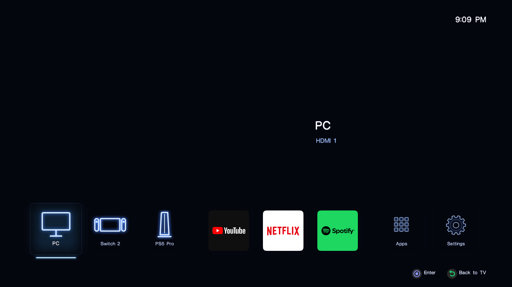
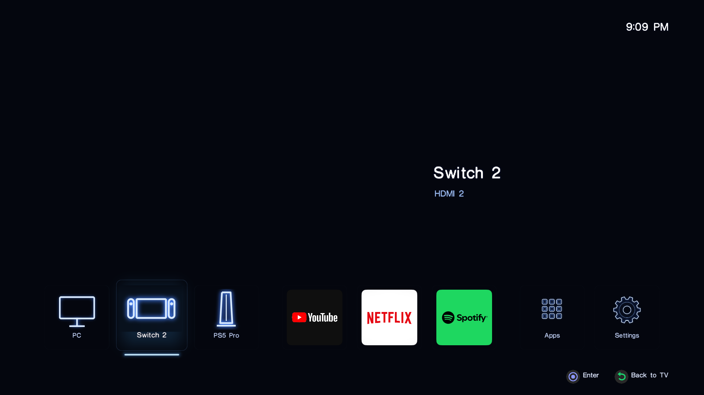
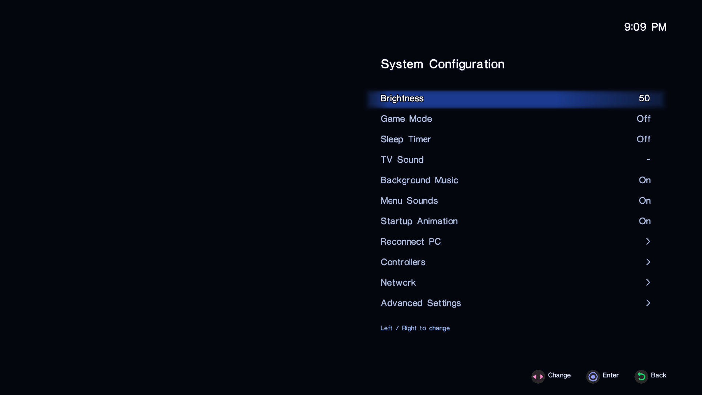

# PS2-style Quiet Home

This fork replaces Quiet Home's interface with one modelled on the PlayStation 2
system menu ("browser" era). It is the launcher that ran on the S90D case-study
TV (`QN55S90DAFXZA`, firmware `T-PTMDAKUC-0090-2130.0`). Hardware status for that
TV: built against its own framework assemblies and run as Home/startup. Boot,
menu video, ambience, sounds, HDMI switching, app launches, the settings page
and the Settings-button bridge were checked by the owner. The full
restart/standby/wake test is still to be reported.





*Screens captured from the TV's graphics layer. The moving PS2 background video
plays on the TV's video plane behind them, so it isn't in the captures. The
console icons are this repository's generic placeholders.*

## What it does

| Part | Notes |
|---|---|
| Boot clip | Plays once on start (can be turned off). The TV's player crashes on end-of-stream, so the clip is set to loop and stopped by position (`BootEndMs`). |
| Menu background | Looping 4K video on the hardware video plane (`VideoView.Underlay`, window in transparent mode) under the UI. |
| Ambience and sounds | Native `wav_player` through a media stream; cursor, select and back clicks, plus a looping ambience. Each can be turned off in Settings. |
| Text | The PS2 system font, pre-rendered at every on-screen size and drawn 1:1, so nothing is rescaled on the TV. |
| Dock | Inputs, favourite apps, Apps and Settings, all configured in `launcher/assets/theme.json`. |
| Apps page | Every installed app from `apps.json` (or your ignored `apps.local.json`). |
| Settings | Brightness, Game Mode, Sleep Timer, TV Sound, Background Music, Menu Sounds, Startup Animation, **Reconnect PC**, Controllers, Network and Advanced (Samsung's own menu). |
| Reconnect PC | Turns HDMI 1's Input Signal Plus (`uhd-color-hdmi1`) off and on, which forces a fresh HDMI handshake. It helped with a PC that sometimes came up with no signal. It is not a fix for a cable, driver or EDID problem. |

There is no volume slider. On this TV with an eARC receiver, the sound-manager
volume calls didn't reach the receiver, so the row was removed and the remote's
own volume buttons are used.

## Nothing from Sony is in this repository

The font, the menu sounds, the boot and menu videos and the ambience all come
from the PS2 BIOS. They are Sony's copyrighted material and are **not**
included. `.gitignore` keeps `launcher/assets/ps2/font/`, `sfx/` and `media/`
out of commits. You build them from a BIOS dump of your own console:

```sh
python3 tools/ps2_assets.py all /path/to/your-own-bios.bin
```

That unpacks the OSD resources into `.local/ps2-bios/`, renders the font
atlases into `launcher/assets/ps2/font/`, regenerates
`launcher/src/Ps2FontMetrics.cs`, and writes `cursor.wav`, `select.wav` and
`back.wav` (SNDOSDDB samples 6, 8 and 12 at 22.05 kHz, set to the levels tuned
on the S90D). It was checked against an NTSC SCPH-39001 dump. The output
reproduced the font metrics and sound levels that ran on the TV exactly.

### Videos and ambience: record them yourself

Record your own BIOS in PCSX2 at 4K (any codec; ffmpeg re-encodes it). Then
convert it. The cut points are from the case-study recording; pick your own seamless loop point.

```sh
# Menu background: a seamless 3-minute loop, silent, H.264 High@5.2 (the TV's player accepts this)
ffmpeg -ss 50.434 -t 180.18 -i menu-recording.mp4 -an \
  -c:v libx264 -preset slow -crf 18 -profile:v high -level 5.2 -pix_fmt yuv420p \
  launcher/assets/ps2/media/menu_loop.mp4

# Boot clip: trim, then zoom past the recording's letterbox so it fills 16:9
ffmpeg -ss 1.001 -to 13.614 -i boot-recording.mp4 \
  -vf "crop=2808:1580:516:288,scale=3840:2160:flags=lanczos" \
  -c:v libx264 -preset slow -crf 18 -profile:v high -level 5.2 -pix_fmt yuv420p -c:a aac \
  launcher/assets/ps2/media/boot.mp4
# Optional: hide on-screen text by adding  ,delogo=x=..:y=..:w=..:h=..:enable='between(t,A,B)'

# Ambience: a loopable stretch of the menu audio, 48 kHz stereo WAV
ffmpeg -ss 50 -t 93.7 -i menu-recording.mp4 -vn -ar 48000 -ac 2 -c:a pcm_s16le \
  launcher/assets/ps2/media/ambience.wav
```

Find your letterbox with `ffmpeg -i boot-recording.mp4 -vf cropdetect -f null -`.
Set `BootEndMs` in `theme.json` to just before your clip's last frame.

## Build and install

The build and install are the same as Quiet Home ([launcher guide](04-launcher.md)):
build with `tools/build.py launcher --framework .local/tv-framework`, then
`recipes/install-launcher.sh`. To update an installed copy in place (new assembly
and/or a tarball of resources), use `recipes/s90d/update-launcher.sh`.
`recipes/s90d/try-theme.sh full` relaunches it and prints its state file. The
other theme variants (`novideo`, `loop-texture`, `loop-underlay`, `boot-texture`)
were used to isolate video problems.

Edit `theme.json` for your inputs. Source IDs `13`–`16` were HDMI 1–4 on this
TV; check yours with Probe. App icons may point at the icon files of apps
installed on the TV (`/opt/usr/apps/...`). Those are read at runtime and never
copied into the repository.

## S90D extras

| Recipe | Purpose |
|---|---|
| `recipes/s90d/install-settings-bridge-s90d.sh` / `restore-…` | Settings bridge for this TV. It has a second `XF86More` rule (a function-osd preload), so only the QuickLaunch rule and `XF86SysMenu` are rerouted. Round-trip and drift tests: `tests/test_routing_s90d.py`. |
| `recipes/s90d/oneshot.py` | The `screen-sharing`, `multi-device`, `light-shell` and `shell-extras` groups, the AirPlay/Cast/bms stop markers, Multi View's own `disable_preloading` switch and the settings bridge, in one guarded run with a matching `restore`. |
| `recipes/s90d/restore-all.py` | Undoes every round newest-first, then restores the stock launcher and Home/startup. You pass your TV's original values. |
| `recipes/s90d/preview-shots.sh`, `screenshot.sh` | Capture the UI layer (`enlightenment_info -dump_screen`) for review. |

The AirPlay and Google Cast services kept running after their apps were disabled
in the registry: systemd starts them directly. Samsung TV Plus kept coming back
through `org.tizen.bms-service`, which isn't in the `tv-plus` group. The
`unused-features`/`shell-extras` stop markers cover both.

## Attribution

The layout and behaviour imitate the PS2 system menu for personal use. This
project is not affiliated with Sony Interactive Entertainment. "PlayStation" and
"PS2" are its trademarks, and other product names belong to their owners.
